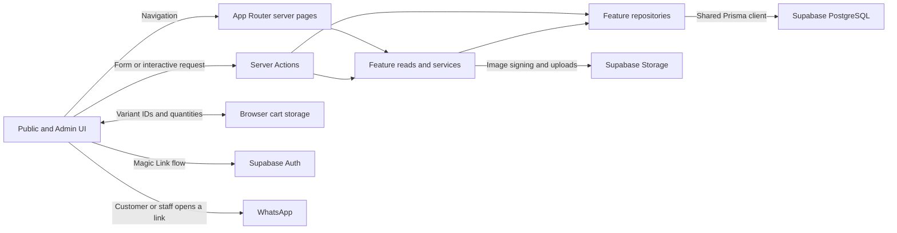

# JPScents Codebase Intelligence Report

- **Assessment date** — 12 November 2026
- **Inspected commit** — `cda1783b792fa392ff0f0563d948d9eaa6e07837` (`main`)
- **Status** — Descriptive baseline. Findings and recommendations record the assessment and carry no architectural approval.

## 1. Executive summary

JPScents is a Nigerian perfume storefront with a protected Admin console. Shoppers browse by scent, select a size, and place a guest order in NGN. Checkout saves the order and deducts stock before the customer continues to WhatsApp for manual payment and delivery. Staff manage catalogue content, stock, customers, and fulfilment in the same application. [Product overview](../README.md#L3) · [Commerce configuration](../src/config/commerce.ts#L1)

The architecture is a **modular Next.js monolith** with four feature domains, Prisma-backed PostgreSQL, and Supabase Auth and Storage. It is a good fit for the current workflow. The highest-value work is in the rules where catalogue, inventory, and order history meet. The database trigger can block checkout for the last unit of a bestseller, later customer edits change the delivery details displayed on existing orders, and a stale Admin variant edit can overwrite stock changed by checkout.

**Verification.** I assessed local `main` at `cda1783`, seven commits ahead of the locally recorded `origin/main`. Architecture, formatting, lint, and type checks passed on Node 24.14.1. Vitest passed **135 tests across 26 files**, with one passing order test logging a `TypeError`. I used the existing generated Prisma client and disabled test caching and incremental type-check output. The working tree stayed clean. The production build, fresh setup, live database behavior, and hosted integrations remain unverified.

## 2. Feature matrix

“Implemented” means the source contains a connected UI and execution path. Verification is described in §6.

| Feature                           | Status                            | Frontend and state                                                                                                                                         | Backend and persistence                                                                                                                                                                                                                                                                                                                                               |
| --------------------------------- | --------------------------------- | ---------------------------------------------------------------------------------------------------------------------------------------------------------- | --------------------------------------------------------------------------------------------------------------------------------------------------------------------------------------------------------------------------------------------------------------------------------------------------------------------------------------------------------------------- |
| Storefront and product discovery  | Implemented                       | `/`, `/perfumes`, `/perfumes/[slug]`. URL scent filter and local size/quantity selection.                                                                  | Dynamic server pages read published products, resolve images, and render cards, details, related products, and SEO metadata. [Catalogue page](../src/app/%28public%29/perfumes/page.tsx#L20) · [Public catalogue service](../src/features/catalogue/services/public-catalogue.service.ts#L29)                                                                         |
| Scent guidance                    | Implemented                       | `/help-me-choose`. Local preference controls submit scent character, occasion, and time of day through the URL.                                            | Ranks in-stock published products by preference overlap, with bestseller and featured tie-breakers. [Route](../src/app/%28public%29/help-me-choose/page.tsx#L17) · [Ranking](../src/features/catalogue/services/public-catalogue.service.ts#L69)                                                                                                                      |
| Cart                              | Implemented                       | Public-shell preview and `/cart`. React context and a cart hook persist variant IDs and quantities in browser storage and sync across tabs.                | `resolveCart` uses the catalogue’s server API for current price, stock, and availability. Invalid lines stay visible for correction. [Cart state](../src/features/cart/hooks/useCartState.ts#L23) · [Cart resolution](../src/features/cart/actions/resolve-cart.action.ts#L41)                                                                                        |
| Guest checkout and confirmation   | Implemented with operational gaps | `/checkout` and `/checkout/confirm`. Checkout owns form state and a retry key. Confirmation shows a reference and opens a prefilled WhatsApp conversation. | `submitOrder` validates and saves an order, then sets a confirmation cookie. Payment, WhatsApp messaging, and delivery coordination are manual. [Checkout hook](../src/features/orders/hooks/useCheckout.ts#L12) · [Submit action](../src/features/orders/actions/submit-order.action.ts#L6) · [Confirmation](../src/features/orders/components/Confirmation.tsx#L59) |
| Admin access                      | Implemented                       | `/admin/login` and the protected `/admin` layout.                                                                                                          | Supabase Magic Link, `/auth/confirm`, cookie session refresh, and Admin identity checks on protected reads and writes. [Login action](../src/app/%28admin-auth%29/admin/login/_actions/request-magic-link.action.ts#L16) · [Callback](../src/app/auth/confirm/route.ts#L10) · [Admin layout](../src/app/%28admin%29/admin/layout.tsx#L15)                             |
| Catalogue and merchandising Admin | Implemented                       | `/admin` and `/admin/perfumes*`. Overview, filters, editor, variants, primary image, featured placement, and bestseller selection.                         | Admin actions validate inputs. Prisma stores products and image metadata. Supabase Storage holds uploaded images. [Admin overview](../src/app/%28admin%29/admin/page.tsx#L9) · [Save action](../src/features/catalogue/actions/save-perfume.admin.action.ts#L28) · [Image service](../src/features/catalogue/services/perfume-images.service.ts#L44)                  |
| Customer Admin                    | Implemented                       | `/admin/customers*`. Search, create, edit, order history, and deletion for customers without orders.                                                       | Admin actions and repository enforce contact uniqueness and deletion rules. Checkout also writes customer records. [Customer service](../src/features/customers/services/customer.service.ts#L5) · [Customer repository](../src/features/customers/repositories/customer.repository.ts#L88)                                                                           |
| Order Admin                       | Implemented                       | `/admin/orders*`. Filtered list, order detail, activity, WhatsApp follow-up, status changes, and cancellation.                                             | Orders repository records status events and restores stock on cancellation. Cancelled orders are terminal. Other statuses can move in either direction. [Admin detail](../src/features/orders/components/AdminOrderDetail.tsx#L135) · [Status and cancellation](../src/features/orders/repositories/order.repository.ts#L190)                                         |

Customer accounts, customer-facing order history, automated payment, automated fulfilment, and unpaid-order expiry have no implementation in the inspected routes or workflows. The repository does not establish a delivery plan for them.

## 3. Architecture map

- **Stack.** Node 24, Next.js 16.3.3 App Router, React 19.2.8, strict TypeScript, Tailwind 4, shadcn/Radix foundations, and Motion. Prisma 7.9.1 uses the PostgreSQL adapter and a lazy, reused client with a one-connection pool per runtime instance. [Manifest](../package.json#L7) · [Prisma client](../src/db/prisma.ts#L8)
- **Ownership.** `src/app` composes routes. `src/features` owns domain behavior. `src/components` and `src/shared` provide reusable presentation and formatting. `src/lib`, `src/config`, and `src/db` provide infrastructure and configuration. Cross-feature dependencies are narrow. Cart reads published variants through `catalogue/server.ts`, and the orders repository calls the customer repository’s public operation using the existing transaction. Checkout’s route-local wrapper connects Cart and Orders. [Cart action](../src/features/cart/actions/resolve-cart.action.ts#L3) · [Checkout wrapper](../src/app/%28public%29/checkout/_components/Checkout.tsx#L3) · [Order transaction](../src/features/orders/repositories/order.repository.ts#L136)
- **Data.** A perfume owns variants and image metadata. An order links to one customer, line items, and status events. Line quantity and unit price are stored with the order. Product labels and delivery details come from related records at read time. Prisma migrations also own PostgreSQL constraints, triggers, access grants, and Storage policies. [Schema](../prisma/schema.prisma#L41) · [Order mapper](../src/features/orders/mappers/order.mapper.ts#L10) · [Migration ownership](../prisma/README.md#L3)

## 4. Execution flows

1. **Browse → select → cart.** The server reads published perfume rows and maps them to storefront data with signed image URLs. Product controls cap quantity against the displayed stock and the configured per-variant limit. The cart persists minimal input and resolves it server-side when contents change or the preview is reopened. A resolved cart is a snapshot. Checkout checks stock again. [Public reads](../src/features/catalogue/services/public-catalogue.service.ts#L38) · [Variant controls](../src/app/%28public%29/perfumes/%5Bslug%5D/_hooks/useVariantPurchaseControls.ts#L9) · [Cart refresh](../src/features/cart/hooks/useCartState.ts#L66)
2. **Checkout → save → WhatsApp.** The action validates contact and Nigerian delivery details, merges duplicate cart lines, and passes a submission key into the repository. One transaction checks for a prior submission, deducts stock conditionally, resolves the customer, calculates totals from database prices, and saves the order and its initial `AWAITING_PAYMENT` event. After commit, the action sets a 24-hour HTTP-only confirmation cookie. The client clears the cart and navigates to confirmation, where the customer can open WhatsApp. [Submission parser](../src/features/orders/parsers/order-submission.parser.ts#L38) · [Atomic write](../src/features/orders/repositories/order.repository.ts#L89) · [Confirmation cookie](../src/features/orders/server/confirmation-cookie.ts#L11)
3. **Admin sign-in → operate.** The login action requests a Magic Link for a configured Admin address. The callback verifies the session and checks both the email allowlist and server-controlled Admin role. The layout redirects unauthorised users. Protected reads and mutations also check identity at their own boundaries. [Login action](../src/app/%28admin-auth%29/admin/login/_actions/request-magic-link.action.ts#L25) · [Identity](../src/lib/auth/identity.ts#L7) · [Order read guards](../src/features/orders/services/order.service.ts#L58)
4. **Catalogue write → storefront.** The editor posts staged values and files to Server Actions. Publishing validates image and stock prerequisites. For a new perfume, the service uploads the image, saves the database records together, and attempts to remove the uploaded file if saving fails. Image replacement commits metadata before cleaning up the previous object. Public routes read published data on request. [Publish validation](../src/features/catalogue/validators/publishing.validator.ts#L3) · [Create service](../src/features/catalogue/services/save-perfume.service.ts#L8) · [Image replacement](../src/features/catalogue/services/perfume-images.service.ts#L44)
5. **Order follow-up → status or cancellation.** Admin reads the order and activity history, then records the outcome of manual payment or delivery. Cancellation conditionally claims the order using its current status and restoration marker, increments the recorded variant quantities, and appends an event in one transaction. Repeating a completed cancellation leaves stock unchanged. [Order status repository](../src/features/orders/repositories/order.repository.ts#L190)

## 5. Engineering conventions

| Area                 | Established practice and where it varies                                                                                                                                                                                                                                                                                                                                                                                                                                                                                                                                                                                                        |
| -------------------- | ----------------------------------------------------------------------------------------------------------------------------------------------------------------------------------------------------------------------------------------------------------------------------------------------------------------------------------------------------------------------------------------------------------------------------------------------------------------------------------------------------------------------------------------------------------------------------------------------------------------------------------------------- |
| Feature structure    | Export-only `index.ts`, `client.ts`, and `server.ts` entry points as needed. Page-only components stay beside their route. Repositories own Prisma and transaction boundaries, services coordinate work, and mappers shape data. The architecture checker passed for all four features. Its enforcement is structural and cannot establish runtime correctness. [Feature rules](../.agents/skills/feature-structure/SKILL.md#L16)                                                                                                                                                                                                               |
| APIs and validation  | Server Components read through feature APIs. Interactive writes call Server Actions. Most forms use small TypeScript parsers and structured field errors. Error envelopes vary by feature, and cart resolution throws on malformed input. Follow the caller’s existing contract. [Customer save](../src/features/customers/actions/save-customer.admin.action.ts#L12) · [Cart input](../src/features/cart/actions/resolve-cart.action.ts#L11)                                                                                                                                                                                                   |
| State and types      | Local hooks own interactive state, query parameters carry filters and recommendations, and cart context is the shared browser state. Money is stored in integer minor units. Public and Admin order projections expose different fields. [Checkout state](../src/features/orders/hooks/useCheckout.ts#L12) · [Order projections](../src/features/orders/mappers/order.mapper.ts#L26)                                                                                                                                                                                                                                                            |
| Security and logging | Admin requires a trusted email and `app_metadata.role`. SQL migrations revoke application-table access from browser roles and enable RLS. Storage reads are allowed for the catalogue prefix, including draft objects, while writes require an Admin JWT role. Treat that prefix as customer-visible media. Server Function argument logging is disabled because checkout carries personal information. [Table grants](../prisma/migrations/20260828000000_initial_platform/migration.sql#L156) · [Storage policies](../prisma/migrations/20260829000000_signed_perfume_image_reads/migration.sql#L8) · [Logging config](../next.config.ts#L16) |
| Tooling              | The lockfile pins resolved dependencies. Prettier, ESLint, strict TypeScript, Vitest, and Testing Library run through the repository’s quality scripts. Tests live under root `tests/`, generally mirroring source ownership. [Quality scripts](../package.json#L9) · [Vitest config](../vitest.config.ts#L4)                                                                                                                                                                                                                                                                                                                                   |

## 6. Technical health

The strongest implementation choices are server-side price and stock checks, transactional stock and order writes, database uniqueness for duplicate submissions, and public order responses that omit customer details. The biggest confidence gap is that the suite mocks Prisma, Supabase, or Next.js at the boundaries that determine whether those behaviors hold in a deployment. [Order transaction tests](../tests/src/features/orders/services/order.service.test.ts#L22) · [Auth callback tests](../tests/src/app/auth/confirm/route.test.ts)

| Severity   | Finding                                                                                                     | Evidence and impact                                                                                                                                                                                                                                                                                                                                                                                                                                                                                                                                                                                         |
| ---------- | ----------------------------------------------------------------------------------------------------------- | ----------------------------------------------------------------------------------------------------------------------------------------------------------------------------------------------------------------------------------------------------------------------------------------------------------------------------------------------------------------------------------------------------------------------------------------------------------------------------------------------------------------------------------------------------------------------------------------------------------- |
| **High**   | **A bestseller can be shown in stock but fail at checkout.** Confirmed by source and SQL inspection.        | Checkout decrements variant quantity. The variant trigger raises when that decrement leaves the active bestseller with no positive-stock variant. The order service converts the failure into a generic retry message. The last stock remains unavailable for sale until an Admin changes the placement or adds stock. [Stock update](../src/features/orders/repositories/order.repository.ts#L115) · [Trigger registration](../prisma/migrations/20260828000000_initial_platform/migration.sql#L150) · [Trigger body](../prisma/migrations/20260828201815_harden_bestseller_search_path/migration.sql#L20) |
| **High**   | **Existing orders display mutable delivery and product data.** Confirmed in source.                         | A repeat checkout updates the shared customer record. Admin detail reads that record’s current name, contact, and delivery address, so an earlier outstanding order can display the new address. Existing item names and sizes also follow catalogue edits. The recorded price remains stable. [Customer update](../src/features/customers/repositories/customer.repository.ts#L88) · [Order mapping](../src/features/orders/mappers/order.mapper.ts#L10)                                                                                                                                                   |
| **High**   | **A stale variant edit can overwrite a stock movement.** Confirmed write behavior.                          | The editor submits the displayed quantity even during a price or size edit. The repository writes that absolute value without checking the version the operator saw. Checkout or cancellation between opening and saving the form can therefore be overwritten. [Variant editor](../src/features/catalogue/components/admin/VariantManager.tsx#L139) · [Variant update](../src/features/catalogue/repositories/variant.repository.ts#L33)                                                                                                                                                                   |
| **Medium** | **The upload contract exceeds the documented hosting limit.** Repository and vendor mismatch.               | The app accepts 5 MiB files via a Server Action and allows a 6 MB action body. Vercel documents a 4.5 MB Function payload limit. A deployment using that limit can reject files the UI says it accepts. [Image validator](../src/features/catalogue/validators/image.validator.ts#L1) · [Action config](../next.config.ts#L20) · [Vercel payload limit](https://vercel.com/docs/errors/function_payload_too_large)                                                                                                                                                                                          |
| **Medium** | **Unpaid guest orders tie up stock until staff cancel them.** Confirmed lifecycle, unknown business impact. | Stock is deducted before payment and WhatsApp follow-up. I found no expiry, automated release, or application-level checkout throttling. Impact depends on abandonment, traffic, operator response, and any hosted controls. [Checkout write](../src/features/orders/repositories/order.repository.ts#L89) · [Cancellation](../src/features/orders/repositories/order.repository.ts#L219)                                                                                                                                                                                                                   |
| **Medium** | **A green test misses failure in the returning-customer path.** Observed during execution.                  | The test awaits `createOrder` but ignores its result in the success branch. The `customerUpdate` mock lacks a return value, and the service logged a `TypeError` while the assertions on calls still passed. The conflict branch separately checks the returned error. [Mock setup](../tests/src/features/orders/services/order.service.test.ts#L128) · [Test assertions](../tests/src/features/orders/services/order.service.test.ts#L208)                                                                                                                                                                 |

At current scale, unpaginated lists and per-image signing are measurement targets. The public catalogue loads variants and images, sorts the result in memory, and signs one image per returned card. The Admin overview also fetches and signs bestseller candidates. The code establishes the cost grows with the catalogue. Traffic and timing evidence would establish whether it matters. [Published query](../src/features/catalogue/repositories/perfume.repository.ts#L99) · [Public list](../src/features/catalogue/services/public-catalogue.service.ts#L38) · [Admin candidate list](../src/features/catalogue/services/admin-catalogue.service.ts#L46)

## 7. Development and deployment

- **Local development.** Use Node 24, `npm ci`, Docker, and the Supabase CLI. `setup:local` starts Supabase, resets the local database, and applies the Prisma migration history. An operator configures the environment, provisions Admin, and runs `npm run dev`. The local inbox captures Magic Links. Demo data is opt-in. The setup guide omits `npm run db:generate`. The client is ignored, `dev` and `check` have no generation hook, and `prebuild` is the configured automatic generation path. This is a clean-checkout onboarding gap. [Setup guide](../README.md#L56) · [Scripts](../package.json#L10) · [Generated client](../prisma/README.md#L3)
- **Production.** The documented target is Vercel with hosted Supabase. Apply committed migrations before dependent code, then build with `npm run build`. Hosted Auth needs the exact callback URL, the checked-in email template, provisioned Admin claims, and client-owned SMTP. The repository contains local Supabase configuration and a manual release smoke checklist. No tracked CI workflow or Vercel configuration establishes which checks are enforced remotely. [Production configuration](../README.md#L123) · [Deployment checklist](../README.md#L133)
- **Operations and recovery.** The code provides console diagnostics, order status history, retry handling, and best-effort image cleanup. Auth lookup errors appear as a signed-out state, and image signing errors fall back to missing images. I found no repository-owned alerts, health endpoint, or restore drill. Hosted monitoring and backups need operator verification. [Auth lookup](../src/lib/auth/admin.ts#L8) · [Image signing](../src/lib/supabase/storage.ts#L7) · [Cleanup diagnostics](../src/features/catalogue/services/perfume-images.service.ts#L25)

| Configuration scope                    | Variable names                                                                                                                                                   |
| -------------------------------------- | ---------------------------------------------------------------------------------------------------------------------------------------------------------------- |
| Documented application runtime         | `DATABASE_URL`, `NEXT_PUBLIC_SITE_URL`, `NEXT_PUBLIC_SUPABASE_URL`, `NEXT_PUBLIC_SUPABASE_PUBLISHABLE_KEY`, `JP_SCENTS_ADMIN_EMAIL`, `JP_SCENTS_WHATSAPP_NUMBER` |
| Optional runtime                       | `JP_SCENTS_SECONDARY_ADMIN_EMAIL`                                                                                                                                |
| Operator tooling                       | `DIRECT_URL` for migrations, `SUPABASE_SECRET_KEY` for provisioning, `APP_ENV_FILE` to select the operator’s configuration file                                  |
| Compatibility aliases accepted in code | `SUPABASE_URL`, `SUPABASE_PUBLISHABLE_KEY`, `SUPABASE_ANON_KEY`, `NEXT_PUBLIC_SUPABASE_ANON_KEY`, `SUPABASE_SERVICE_ROLE_KEY`                                    |

The runtime checker requires the documented names. Keep the migration connection and provisioning credential out of Vercel. [Environment checker](../scripts/check-environment.mjs#L5) · [Supabase config](../src/lib/supabase/config.ts#L7) · [Provisioning](../scripts/provision-admin.mjs#L4)

## 8. Agent playbook

1. **Start at the route and follow the actual call chain.** Find the route under `src/app`, then follow its feature entry point, client hook, action, service, or repository. Keep cross-feature UI composition route-local and put domain rules in the owning feature. [Feature locality rules](../.agents/skills/feature-structure/SKILL.md#L113)
2. **Review cross-domain effects for any stock, order, or customer change.** Read the Prisma schema and SQL migrations alongside the repository. Preserve duplicate-submission handling, conditional stock updates, single restoration, authorization at each entry point, and the separation of public and Admin data. Keep network calls outside database transactions. [Transaction guidance](../prisma/README.md#L5)
3. **Verify through the normal entry point.** Run targeted tests and `npm run check`. For transaction or migration changes, add a disposable PostgreSQL/Supabase check with actual migrations applied. For framework or hosting changes, run a production build in an isolated copy with synthetic configuration. Exercise Magic Link, image upload, checkout, and confirmation on an authorised preview when those paths change. Next and Prisma commands can auto-load environment files in the configured checkout. [Agent verification guide](../README.md#L165)

## 9. Prioritised recommendations

| Rank | Action                                                                                                                                                                                                                                                                                                               | Urgency and rough effort                                                      |
| ---- | -------------------------------------------------------------------------------------------------------------------------------------------------------------------------------------------------------------------------------------------------------------------------------------------------------------------- | ----------------------------------------------------------------------------- |
| 1    | **Make the final bestseller unit purchasable.** Decide that selling out clears the placement or makes it ineligible for display, then enforce the chosen rule with the stock transaction. Verify the last-unit sale and rollback against migrated PostgreSQL.                                                        | Before relying on bestseller placement · 1–2 days                             |
| 2    | **Preserve order-time fulfilment data.** Snapshot the delivery contact and address when an order is placed. Decide whether order-time product name and size belong in the same change. Treat historical backfill as best effort because the original values may already be lost.                                     | Before routine fulfilment · 2–3 days                                          |
| 3    | **Reject stale inventory writes.** Add an optimistic check to stock edits or make stock adjustments explicit. Verify that a price-only edit preserves stock changed by a sale or cancellation.                                                                                                                       | Before frequent Admin inventory edits · 1–2 days                              |
| 4    | **Add a small release gate.** Fix the false-green test, document client generation for a fresh checkout, and add a disposable integration run for last-unit checkout, duplicate submission, rollback, and repeat cancellation. Align the upload limit with the deployed request budget and smoke-test it in preview. | Next release · 2–4 days                                                       |
| 5    | **Measure unpaid orders before automating expiry.** Agree when staff should cancel an unpaid order, then measure order age and stock held. Use the result to decide whether an expiry rule or hosted throttling is warranted.                                                                                        | Once order volume makes the problem visible · hours to set up a manual review |

## 10. Unknowns

- Which commit and migrations are deployed, whether previews have isolated data, and whether Vercel enforces checks before production deployment.
- Whether hosted SMTP, Magic Link redirects, Storage policies, request controls, alerts, and backup or restore procedures match the documented setup.
- How often staff edit stock during active ordering, how many unpaid orders accumulate, and whether operators intentionally move orders backwards between non-cancelled statuses.
- Production catalogue size, signing latency, database pool contention, and whether any route currently needs pagination.
- Dependency advisory status and behavior on real PostgreSQL, Supabase, browser, and Vercel boundaries. The local checks establish a passing source baseline for the inspected commit.
