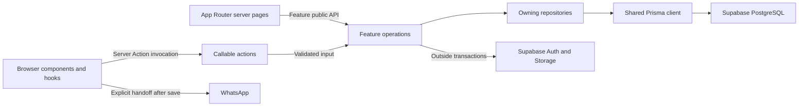

# JPScents architecture contract

**APPROVED**

- **Approved** — 12 November 2026. The repository owner approved D1–D5 as recommended in the architecture review.
- **Evidence baseline** — Local `main` at `cda1783b792fa392ff0f0563d948d9eaa6e07837`, [Codebase Intelligence](../CODEBASE_INTELLIGENCE.md) and [Controls Audit](../engineering/CONTROLS_AUDIT.md), checked against representative routes, feature modules, SQL, and checker source.
- **Scope** — Ownership, dependencies, runtime and data boundaries, and evidence of compliance. Naming style, formatting, and general coding style belong to Task 5. The 22 rules below are the approved architecture contract. [Project instructions](../../AGENTS.md#L13) continue to govern repository work. The evidence baseline describes the inspected implementation and tooling. See [implementation and enforcement gaps](#implementation-and-enforcement-gaps) for work still open.

## 1. System model and domain boundaries

JPScents is a modular Next.js monolith. Server Components render application reads. Server Actions handle interactive server calls. Prisma and PostgreSQL are the application data path. Supabase provides Admin identity and image storage. WhatsApp opens a conversation for manual follow-up after the order has been saved. It has no role in order persistence or payment-state transitions. [Product and routes](../../README.md#L3) · [Commerce mode](../../src/config/commerce.ts#L1)

| Owner                                    | Data and behaviour                                                                                                                                                                                                                                                                                                 |
| ---------------------------------------- | ------------------------------------------------------------------------------------------------------------------------------------------------------------------------------------------------------------------------------------------------------------------------------------------------------------------ |
| **Catalogue** · `src/features/catalogue` | Perfumes, variants, stock quantities, image metadata and upload workflows, publication, merchandising, and recommendations. Owns stock persistence and checkout stock operations under D2.                                                                                                                         |
| **Cart** · `src/features/cart`           | Browser cart state, minimal persisted variant IDs and quantities, preview, and resolution against current Catalogue data. It has no database tables.                                                                                                                                                               |
| **Customers** · `src/features/customers` | Customer identity, unique contacts, mutable customer profile and delivery defaults, Admin maintenance, and customer resolution for checkout.                                                                                                                                                                       |
| **Orders** · `src/features/orders`       | Checkout input, order creation and cancellation, placed amounts, order status/history, confirmation capability, and manual WhatsApp handoff. Owns order transactions and order-time facts under D2–D3.                                                                                                             |
| **Application and infrastructure**       | `src/app` composes public and Admin routes, handles framework entry points, and owns page-specific composition. `src/components` and `src/shared` hold independent reusable presentation and utilities. `src/config`, `src/lib`, and `src/db` supply configuration, Auth, provider transport, and client lifetime. |

### Dependency map

| Consumer                           | Permitted path                                                                                                                                                                                  |
| ---------------------------------- | ----------------------------------------------------------------------------------------------------------------------------------------------------------------------------------------------- |
| Route or shell                     | Public APIs of the features it composes, local presentation, and independent shared code. The product detail and checkout routes compose Cart with Catalogue and Orders respectively.           |
| Browser module                     | Browser-safe feature exports and shared modules. A Next.js Server Action import is a callable server reference. Privileged implementations and database clients stay outside the browser graph. |
| Cart → Catalogue                   | Published variant lookup through `catalogue/server.ts`. Cart owns the requested basket, while Catalogue supplies authoritative variant data.                                                    |
| Orders repository → Customers      | `resolveCustomerForOrder` through `customers/server.ts`, using the Orders transaction.                                                                                                          |
| Orders repository → Catalogue      | Purpose-specific stock deduction and restoration through `catalogue/server.ts`, using the Orders transaction (D2).                                                                              |
| Feature → infrastructure or shared | Server/client-compatible APIs appropriate to the caller. Shared infrastructure and generic UI remain independent of features.                                                                   |

## 2. Rules and verification key

Rule IDs are stable references for changes and reviews. **S** means static analysis or framework compilation, **A** means architecture fixtures that exercise a boundary check, **I** means integration evidence through the relevant real boundary, and **R** means independent architectural review. Behaviour tests with mocks supplement these modes. In the verification column, **Existing** describes controls observed at the evidence baseline. **Required** describes how compliance with the approved rule is established. A required check or review may still need to be implemented or performed. The existing checker covers only the cases identified in the verification column.

### Ownership and module contracts

| ID         | Approved mandatory rule                                                                                                                                                                                                                                                                                                                                                                                    | Compliant example                                                                                                                                                      | Non-compliant example                                                                                                                              | Verification                                                                                                                                                                                    |
| ---------- | ---------------------------------------------------------------------------------------------------------------------------------------------------------------------------------------------------------------------------------------------------------------------------------------------------------------------------------------------------------------------------------------------------------- | ---------------------------------------------------------------------------------------------------------------------------------------------------------------------- | -------------------------------------------------------------------------------------------------------------------------------------------------- | ----------------------------------------------------------------------------------------------------------------------------------------------------------------------------------------------- |
| **ARC-01** | Routes MUST own framework entry points, route-specific composition, and route-local UI or adapters. Domain rules, reusable domain UI, and persistence MUST belong to their feature.                                                                                                                                                                                                                        | The route-local checkout adapter passes Cart state to Orders' checkout UI.                                                                                             | The checkout page implements stock deduction or a route-only adapter becomes a global shared component.                                            | **Existing S/A** for feature-to-route imports. **Required R** for semantic ownership and placement.                                                                                             |
| **ARC-02** | A feature root MUST expose only explicit export-only `index.ts`, `client.ts`, or `server.ts` entry points, with optional maintained `README.md` or `AGENTS.md`. Implementations MUST live in their actual responsibility folders. New layers MUST solve a current responsibility with an identifiable consumer. Features MUST NOT create pass-through layers, empty scaffolds, or catch-all modules.       | Cart uses a hook, provider, storage module, and one resolver action. Its root re-exports only what callers use.                                                        | Add a cart repository and forwarding service to mirror Orders, or place the resolver implementation in `index.ts`.                                 | **Existing S/A** for structure and explicit exports. **Required R** for export necessity and cohesive ownership.                                                                                |
| **ARC-03** | Components MUST own presentation and user interaction entry points. Hooks and providers MUST own interaction state, effects, and shared browser state where needed. Browser persistence MUST stay in its owning feature and store only the state needed to resume the workflow. UI MUST NOT make authoritative business or database decisions.                                                             | Cart persists IDs and quantities, then resolves availability on the server. The checkout hook clears the cart after saved success.                                     | Persist a trusted subtotal in local storage or grant the purchase in a client hook based on displayed stock.                                       | **Existing** mocked cart and checkout behaviour tests. **Required R + I** for state ownership, stale data, and browser lifecycle changes.                                                       |
| **ARC-04** | Callable server actions and route handlers MUST own request handling, required authorization, input decoding or delegation to a parser, and framework effects. Server read entry points MUST apply the corresponding authorization and query validation. Services and repositories MUST receive validated, typed input at the workflow boundary. Actions MAY invoke simple repository operations directly. | `savePerfume` guards and parses before dispatch, then redirects. Under D1, `submitOrder` calls the existing parser before invoking `createOrder` with validated input. | A service accepts raw browser input and silently decides which parts are trustworthy, or an Admin action assumes the layout already authorised it. | **Existing** guarded-action tests and examples. **Required R + I** for boundary placement and rejected unauthorised/malformed calls. The Orders discrepancy remains open in the implementation. |
| **ARC-05** | Services MUST own meaningful non-persistence policy or orchestration and MUST NOT own Prisma operations, transaction control, or route effects. Repositories MUST own queries, projections at the database boundary, persistence errors, and atomic checks with their writes. Repositories MUST NOT own provider workflows, cookies, redirects, or UI state.                                               | The image service uploads and compensates around a repository write. The repository checks publish eligibility against rows read in its transaction.                   | A service decides stock sufficiency from an earlier read and issues independent writes, or a repository uploads an image inside its transaction.   | **Existing S/A** for recognisable Prisma access outside repositories. **Required R + I** for effect placement and atomic outcomes.                                                              |
| **ARC-06** | Parsers MUST decode and normalise untrusted data. Extracted validators MUST check domain rules without I/O. A schema module MUST define an actual declarative runtime contract. Mappers MUST purely transform known data into explicit output shapes. Utilities MUST be focused and pure. These roles MUST NOT be hidden in a generically named module or extracted solely for symmetry.                   | `parseCheckoutInput` normalises fields, a location validator checks the state/city, and `toPublicOrder` maps rows using previously resolved image URLs.                | A `*.schema.ts` file wraps only procedural parsing, or an order mapper signs Storage URLs itself.                                                  | **Existing S/A** for category and filename structure. **Required R** for role and purity, supported by behaviour tests for parsing and mapped fields.                                           |

### Dependency and persistence contracts

| ID         | Approved mandatory rule                                                                                                                                                                                                                                                                                                                                                                                                                                                                                                                                                      | Compliant example                                                                                                                                    | Non-compliant example                                                                                                                                   | Verification                                                                                                                                                                                                     |
| ---------- | ---------------------------------------------------------------------------------------------------------------------------------------------------------------------------------------------------------------------------------------------------------------------------------------------------------------------------------------------------------------------------------------------------------------------------------------------------------------------------------------------------------------------------------------------------------------------------- | ---------------------------------------------------------------------------------------------------------------------------------------------------- | ------------------------------------------------------------------------------------------------------------------------------------------------------- | ---------------------------------------------------------------------------------------------------------------------------------------------------------------------------------------------------------------- |
| **ARC-07** | Production consumers outside a feature MUST use its deliberate public API. Feature internals MUST import concrete modules within their own feature. Feature dependencies MUST be acyclic. Features MUST NOT import routes, and generic shared modules MUST NOT import features. New cross-feature edges MUST be reviewed against the dependency map. Tests under root `tests/` MAY import implementation modules to verify owned behaviour or boundaries.                                                                                                                    | Cart consumes a published lookup from `catalogue/server.ts`. The route owns the Cart-to-Orders adapter.                                              | Cart imports Catalogue's repository file, Catalogue depends back on Cart, or a generic dialog imports Orders.                                           | **Existing S/A** for recognised static imports, own-barrel and route/shared edges. **Required R** for a resolved dependency graph including cycles and indirect imports. Current checker does not detect cycles. |
| **ARC-08** | Privileged server modules and server entry points MUST be marked `server-only`. Browser consumers MUST NOT import privileged code or receive server credentials. In features with both runtimes, `index.ts` MUST remain runtime-neutral and client-facing exports MUST use browser-safe entry points. A feature with a single browser surface MAY forward individually marked client modules from `index.ts`. Runtime-neutral contracts MUST use type-only imports when appropriate.                                                                                         | Orders separates its client and server entry points. Cart forwards its client-marked provider from its single entry.                                 | Export an Admin read from a browser barrel, or pull Prisma into a client component to describe props.                                                   | **Existing S/A** for the `server.ts` marker, with partial protection elsewhere. **Required S + R** for the production module graph and **I** for affected route entry points.                                    |
| **ARC-09** | Application Prisma model operations, raw SQL, and transaction creation MUST live in owning repositories. Only application repositories MAY import the shared application client. `src/db/prisma.ts` MUST own lazy client/adapter/pool lifecycle only. Features MUST NOT create clients, disconnect the shared client per request, or expose a live client or delegate as a return value. ARC-10 governs the sole cross-feature use of an existing transaction handle. Standalone seeds MAY own their process client lifecycle and MUST delegate persistence to repositories. | A repository imports `@/db/prisma`. The seed entry creates its process client and invokes the demo repository.                                       | A route runs Prisma directly, a service receives a delegate, or the shared infrastructure module performs an application query.                         | **Existing S/A** for known Prisma forms and path exemptions. **Required R** for aliases, indirect handle flow, lifecycle-only exceptions, and ownership.                                                         |
| **ARC-10** | The repository owning an atomic workflow MUST open and finish its transaction. A cross-feature participant MUST be a purpose-specific repository operation exposed through its owner's server-only API. Every participant MUST use the supplied transaction and return only completed results. Transaction handles MUST NOT pass through routes, actions, services, or browser contracts. Transactions MUST NOT include global-client calls, nested transactions, service callbacks, or network I/O. Cross-domain joins MAY shape a read rooted in the owning aggregate.     | Orders creates the order with Customers' `resolveCustomerForOrder(tx, input)`. An order read selects related customer data for a guarded projection. | Orders opens a transaction but the customer writer calls the global client, or a feature reads another domain's tables to bypass its public capability. | **Existing S/A** for direct transaction syntax in forbidden files. **Required R + I** for same-client participation, rollback, and concurrency.                                                                  |
| **ARC-11** | Prisma MUST remain the application schema and migration authority. Database constraints, triggers, and access policies that Prisma cannot express MUST be maintained in forward SQL migrations. Existing committed migrations MUST NOT be edited. Application-table reads and writes MUST stay behind the trusted server path.                                                                                                                                                                                                                                               | A new migration changes an invariant and is verified against a disposable Supabase/PostgreSQL database.                                              | Edit the initial migration, create a second application migration history, or expose order tables to browser roles to avoid an action.                  | **Existing** migration history with SQL grants and RLS. **Required R + I** for migration diff, migrated database, and role/policy behaviour. Schema validation alone does not check deployed policies.           |

### Security and product invariants

| ID         | Approved mandatory rule                                                                                                                                                                                                                                                                                                                                                                                                                                                                                                                                                | Compliant example                                                                                                                                                     | Non-compliant example                                                                                                                                                         | Verification                                                                                                                                                                                                 |
| ---------- | ---------------------------------------------------------------------------------------------------------------------------------------------------------------------------------------------------------------------------------------------------------------------------------------------------------------------------------------------------------------------------------------------------------------------------------------------------------------------------------------------------------------------------------------------------------------------- | --------------------------------------------------------------------------------------------------------------------------------------------------------------------- | ----------------------------------------------------------------------------------------------------------------------------------------------------------------------------- | ------------------------------------------------------------------------------------------------------------------------------------------------------------------------------------------------------------ |
| **INV-01** | Protected reads and mutations MUST verify the authenticated identity before accessing protected data or performing a write. Admin identity MUST satisfy the configured email allowlist and trusted role. Server responses MUST expose only purpose-specific fields and safe failure information. Public browser contracts MUST NOT include private customer data. Authorized Admin views MAY receive only the customer fields needed for their task. Browser payloads and logs MUST NOT expose server credentials, and logs MUST NOT include private request payloads. | `getOrderByReference` guards before its query. `toPublicOrder` omits contact and internal data. A failure returns safe text and logs operation metadata.              | Treat a hidden Admin button as a guard, trust user-editable role metadata, or return an entire order row from a public action.                                                | **Existing** guarded functions, allowlist/role tests, projection tests, and disabled Server Function argument logging. **Required R + I** for direct unauthorised calls and response boundaries.             |
| **INV-02** | Storefront and Cart reads MUST restrict products to published records. Guest confirmation MUST resolve a server-issued opaque capability from the scoped HTTP-only cookie, with the secure flag in production. The confirmation reference alone MUST NOT authorise lookup. Storage writes MUST remain Admin-only; the catalogue media prefix MUST be treated as customer-visible under its signed-read policy.                                                                                                                                                         | A confirmation route reads the cookie and returns the public projection. A perfume card receives a signed media URL.                                                  | Look up a guest order by its human-readable reference, include the capability in a response body or browser props, or use the catalogue media prefix for confidential assets. | **Existing** published-only queries, cookie/action tests, and SQL policy definitions. **Required R + I** for draft isolation, guest confirmation, and deployed Storage read/write roles.                     |
| **INV-03** | An accepted checkout MUST derive unit prices and totals from authoritative persisted variant data, validate publication and availability at write time, and conditionally deduct stock. Customer resolution, deduction, order lines, and initial `AWAITING_PAYMENT` history MUST commit or roll back together. Customer resolution MUST preserve contact uniqueness and reject conflicting identities. A retry of the same submission key MUST resolve the committed order without another deduction. Client state MUST clear only after saved success.                | A duplicate submission resolves the existing order; a failed stock claim leaves stock, customer and order state unchanged.                                            | Trust client prices, update the customer outside the checkout transaction, or deduct stock twice after a lost response.                                                       | **Existing** database uniqueness/constraints and mocked stock, duplicate, and conflict cases. **Required I + R** for real concurrency, rollback, idempotency, and checkout-to-confirmation behaviour.        |
| **INV-04** | Cancellation MUST claim the order and restore the recorded quantities at most once in the same transaction as the status event. A cancelled order MUST NOT reopen. Generic status updates MUST NOT write `CANCELLED` or bypass history. Until a separate product decision changes the lifecycle, general status updates MUST preserve movement among `AWAITING_PAYMENT`, `PAID`, and `DELIVERED` with concurrency guards.                                                                                                                                              | The cancellation operation claims with the current state and restoration marker before restoring units. A repeated completed cancellation makes no additional change. | Mark an order cancelled through a general status update, restore using the current cart, or let a concurrent status update reopen cancellation.                               | **Existing** guarded conditional writes and mocked action/service tests. **Required I + R** for concurrent cancellation, status races, and rollback on failed restoration.                                   |
| **INV-05** | Catalogue MUST own the deduction and restoration operations that Orders calls within its transaction (D2). Bestseller placement MUST NOT block a purchase that otherwise satisfies checkout rules. When checkout consumes the active bestseller’s final available stock across all variants, Catalogue MUST clear the placement in the same transaction and preserve the one-bestseller invariant. Restocking MUST NOT reassign it automatically.                                                                                                                      | The stock operation and placement change commit together with the order, or both roll back when saving fails.                                                         | Reject a valid sale because of a placement flag, or clear the flag in a second request after checkout.                                                                        | **Existing** conditional decrement, unique bestseller index, and a trigger that currently conflicts with this rule. **Required I + R** for last-unit sale, rollback, and concurrent placement/stock changes. |
| **INV-06** | Order creation MUST persist order-time fulfilment contact and delivery details plus the product name and size sold, alongside existing quantity and price. Order views MUST use those facts for new orders. Legacy orders MUST have explicit fallback semantics and MUST NOT present inferred historical facts as verified snapshots.                                                                                                                                                                                                                                  | A second checkout updates a customer profile while the prior order still shows its own address and line labels.                                                       | Render a placed order's address exclusively from the mutable customer row or backfill guessed originals as historical truth.                                                  | **Existing** price and quantity persistence. Current delivery and product labels are live joins. **Required I + R** for post-order edits, legacy records, and public/Admin projection boundaries.            |
| **INV-07** | A non-stock catalogue edit MUST preserve stock. An explicit absolute stock adjustment MUST condition its write on the stock state or revision observed by the operator, returning a refreshable conflict on staleness. Relative deductions and restorations MUST keep their atomic guards.                                                                                                                                                                                                                                                                             | A price edit succeeds without rewriting quantity. A stock count adjustment conflicts if checkout changed the stock after the editor loaded.                           | Submit and overwrite the quantity from a stale price-edit form.                                                                                                               | **Existing** guarded checkout and cancellation writes. Admin currently writes absolute quantity without a stale-state guard. **Required I + R** for interleaved sale, cancellation, and Admin edits.         |

[Admin identity](../../src/lib/auth/identity.ts#L7) · [Order projections](../../src/features/orders/mappers/order.mapper.ts#L26) · [Confirmation cookie](../../src/features/orders/server/confirmation-cookie.ts#L11) · [Storage policies](../../prisma/migrations/20260829000000_signed_perfume_image_reads/migration.sql#L8) · [Checkout parser](../../src/features/orders/parsers/order-submission.parser.ts#L38)

## 3. Representative execution flows

### Server-rendered reads

**Route → public server API → repository → optional service enrichment and mapper → render.** A protected entry checks identity before querying. Reads use explicit public or Admin projections. Direct repository-backed public reads are appropriate for narrow results with complete visibility constraints. [Product route](../../src/app/%28public%29/perfumes/%5Bslug%5D/page.tsx#L45) · [Published catalogue](../../src/features/catalogue/services/public-catalogue.service.ts#L43) · [Protected order read](../../src/features/orders/services/order.service.ts#L67)

### Cart resolution and guest checkout

**Product controls → Cart hook → resolver action → Catalogue public lookup.** The resolver projects current availability and price. It does not reserve stock. **Checkout hook → `submitOrder` → parse at the action under D1 → Orders service → Orders transaction.** Inside the transaction, Orders checks idempotency, obtains authoritative variants and deducts stock, resolves the customer through Customers, and saves the order and history. Catalogue performs the stock operation within that transaction (D2). The same transaction records order-time fulfilment and line facts (D3). After commit, the service resolves images and maps the result, the action sets the confirmation cookie, and the browser clears the cart and navigates. [Cart resolver](../../src/features/cart/actions/resolve-cart.action.ts#L41) · [Checkout hook](../../src/features/orders/hooks/useCheckout.ts#L35) · [Order transaction](../../src/features/orders/repositories/order.repository.ts#L89) · [Confirmation route](../../src/app/%28public%29/checkout/confirm/page.tsx#L10)

### Stock participation in Orders transactions

Orders opens and completes the transaction for checkout or cancellation. Its repository calls purpose-specific Catalogue repository operations through `catalogue/server.ts` and passes the existing transaction. During checkout, the Customers repository operation receives that same transaction. Catalogue owns the variant and bestseller queries and writes. Orders owns the order claim or submission, line items, customer association, and status history. The participant receives a transaction handle and typed operation input and returns completed results, such as authoritative variant price and product facts for accepted lines. ARC-09 and ARC-10 prohibit exposing the handle beyond participating repositories.

On checkout, Catalogue checks publication and availability, conditionally deducts stock, and clears the placement if the sale consumes the active bestseller's final stock across its variants. These writes must be compatible with the database constraints at commit and during the mutation. On cancellation, Orders first claims the order, then Catalogue restores the recorded quantities by variant ID, including for products unpublished since the sale. A failure rolls back all participating writes. The implementation must verify concurrent stock and placement changes against the actual trigger and uniqueness constraint. The required result is fixed by INV-03 through INV-05. Locking and any forward SQL changes remain implementation choices. [Current checkout stock write](../../src/features/orders/repositories/order.repository.ts#L105) · [Cancellation write](../../src/features/orders/repositories/order.repository.ts#L219) · [Bestseller index and trigger](../../prisma/migrations/20260828000000_initial_platform/migration.sql#L114)

### Admin mutation and external effects

**Editor → guarded action → parser → repository or service → framework response.** A straightforward variant write calls its repository directly. Image creation uses a service because Storage upload, database metadata, and cleanup have different failure boundaries. The service uploads before saving metadata and attempts cleanup on failure. Replacement cleans up the prior object after committing metadata. Report cleanup failures without treating external I/O as transactionally rolled back. [Variant action](../../src/features/catalogue/actions/save-variant.admin.action.ts#L11) · [Perfume save](../../src/features/catalogue/actions/save-perfume.admin.action.ts#L28) · [Image replacement](../../src/features/catalogue/services/perfume-images.service.ts#L44)

### Admin order lifecycle

**Admin detail → guarded status/cancellation action → Orders repository → committed event → refreshed view.** Status changes and cancellation are separate operations. Orders claims the cancellation and calls Catalogue to restore stock inside that transaction. WhatsApp handoff stays an explicit user action. [Status action](../../src/features/orders/actions/change-order-status.admin.action.ts#L10) · [Cancellation action](../../src/features/orders/actions/cancel-order.admin.action.ts#L9) · [Cancellation transaction](../../src/features/orders/repositories/order.repository.ts#L219)

## 4. Verification and exceptions

| ID         | Approved mandatory rule                                                                                                                                                                                                                                                                                                                                                                                                                                                                                                                               | Compliant example                                                                                                             | Non-compliant example                                                                                     | Verification                                                                                                                                                              |
| ---------- | ----------------------------------------------------------------------------------------------------------------------------------------------------------------------------------------------------------------------------------------------------------------------------------------------------------------------------------------------------------------------------------------------------------------------------------------------------------------------------------------------------------------------------------------------------- | ----------------------------------------------------------------------------------------------------------------------------- | --------------------------------------------------------------------------------------------------------- | ------------------------------------------------------------------------------------------------------------------------------------------------------------------------- |
| **VER-01** | Architecture-affecting changes MUST record the affected rule IDs, entry points, exact checked revision, commands, results and limitations. They MUST run the full `npm run check` or its documented isolated equivalent and obtain independent semantic review for affected responsibility and dependency boundaries. Changes to checker behaviour MUST demonstrate compliant and violating cases.                                                                                                                                                    | Record checker results and independently review a new cross-feature participant's ownership, API and transaction use.         | Run only the scoped checker and claim the application graph and responsibilities passed.                  | **Existing** local checks and checker fixtures. **Required S + A + R** against exact reviewed code and recorded evidence.                                                 |
| **VER-02** | Changes to transaction, schema, constraint, or policy behaviour MUST be verified against a disposable database with the applicable migrations. Changes to client/server entry points MUST be verified with an isolated production build and affected route exercise. Changes to cross-boundary Auth, Storage, or browser workflows MUST supply evidence at the affected real boundary. Required unverified evidence MUST remain visible in the release decision. Configured secret files and production data MUST NOT be used for agent verification. | Test concurrent checkout and rollback on disposable PostgreSQL, then report a blocked browser run separately.                 | Claim a mock transaction proves rollback or treat a font-blocked build as successful.                     | **Existing** documented isolation procedure. **Required I + R** with scope-specific evidence. Full build, live database and hosted controls were unverified in the audit. |
| **VER-03** | The existing full quality check MUST pass as a required merge gate on the exact revision eligible for merge (D5). Release approval MUST require the build and integration evidence applicable under VER-02. Any exception to required evidence MUST follow GOV-01. Any hosted gate MUST be verified before it is reported as operational.                                                                                                                                                                                                             | A required check result is tied to the merge candidate, with migrated-database evidence attached for a stock change.          | Treat a manual local run or a ready preview as proof that hosted enforcement exists.                      | **Required S + I + R** using required check results and release evidence. No active hook or tracked CI gate was found. Hosted settings remain unverified.                 |
| **GOV-01** | Any deviation from an approved rule MUST have explicit human approval before introduction or expansion. The decision MUST record the rule ID, scope, evidence, alternatives, trade-off, compensating verification, owner, and expiry or review condition. Existing nonconformance MUST NOT be treated as approval. Agents MUST NOT weaken or bypass a check to admit an undocumented exception.                                                                                                                                                       | Obtain a written, scoped exception for a specific provider boundary and link its review condition and evidence in the change. | Add a hidden barrel, checker exclusion, or permanent “temporary” transaction workaround without approval. | **Required R** checks the approval record and affected evidence. Static checks and fixtures verify any approved mechanical exception within its exact scope.              |

**Allowances within the contract.** ARC-08 covers Cart's single browser entry. ARC-10 covers repository transaction participants through owner-defined server APIs, including Catalogue under D2. ARC-09 covers Prisma infrastructure and standalone seed lifecycles. ARC-07 permits tests to target implementation modules without extending production import permissions. Any deviation beyond these allowances follows GOV-01.

**Reusable method.** For another repository, start from representative user and operator flows. Record who owns each state change, where trust and runtime boundaries sit, and which writes must succeed together. Define the smallest useful dependency graph and write stable, example-backed rules for those decisions. Record the evidence each check provides, the checks still needed, and any conflicts requiring approval. Reuse the method while deriving folder layout, framework primitives, and data invariants from the target repository.

## Approved decisions

| Decision                                                    | Approved standard                                                                                                                                                                                                                                      | Rationale                                                                                                                                                       | Consequences                                                                                                                                                                                                                                                                      | Affected rules                                                                 |
| ----------------------------------------------------------- | ------------------------------------------------------------------------------------------------------------------------------------------------------------------------------------------------------------------------------------------------------ | --------------------------------------------------------------------------------------------------------------------------------------------------------------- | --------------------------------------------------------------------------------------------------------------------------------------------------------------------------------------------------------------------------------------------------------------------------------- | ------------------------------------------------------------------------------ |
| **D1 — Checkout input boundary**                            | `submitOrder` decodes and validates the external payload with the existing parser, then calls Orders with typed workflow input.                                                                                                                        | Makes the callable action the trust boundary and keeps the service focused on orchestration.                                                                    | Move parsing out of `createOrder` while preserving field errors, retry behaviour, and outcomes.                                                                                                                                                                                   | ARC-04, ARC-05, ARC-06, INV-03                                                 |
| **D2 — Checkout stock ownership and final bestseller unit** | Orders owns the transaction. Catalogue owns deduction, restoration, and the atomic clearance of bestseller placement when checkout sells its last available stock. Orders calls Catalogue's purpose-specific server API with the existing transaction. | Keeps stock and merchandising rules with the same domain while preserving order atomicity. Bestseller placement no longer prevents an otherwise valid purchase. | Adds one directed repository-to-repository dependency. Operators select bestseller placement again after restock. Reconcile the existing trigger through compatible transaction sequencing or a forward migration, and verify rollback and concurrent updates against PostgreSQL. | ARC-05, ARC-07, ARC-08, ARC-09, ARC-10, ARC-11, INV-03, INV-04, INV-05, VER-02 |
| **D3 — Historical order facts**                             | New orders persist order-time fulfilment contact and delivery details and the product name and size sold. Retain customer and variant links. Clearly identify legacy fallback where original values are unavailable.                                   | Protects fulfilment and order history from later profile and catalogue edits while preserving navigation and restoration by variant ID.                         | Requires a forward migration and retention of historical contact and address data. Keep those fields out of public responses. Treat unavailable originals as unknown.                                                                                                             | ARC-06, ARC-10, ARC-11, INV-01, INV-03, INV-04, INV-06, VER-02                 |
| **D4 — Admin inventory concurrency**                        | Non-stock edits preserve quantity. Explicit absolute adjustments use an optimistic stock-state check.                                                                                                                                                  | Prevents an Admin edit from losing a checkout deduction or cancellation restoration without introducing an inventory ledger.                                    | The operator may need to refresh and reapply a stale adjustment. Verify the behaviour when the operations overlap.                                                                                                                                                                | ARC-05, INV-03, INV-04, INV-07, VER-02                                         |
| **D5 — Required verification gate**                         | Require the existing full quality check at merge and risk-specific build and integration evidence at release when the affected boundary changes. Verify hosted settings before choosing how to wire enforcement.                                       | Ties evidence to the candidate revision while keeping higher-cost verification focused on changes that need it.                                                 | Requires a merge gate and an evidence path for relevant builds, database tests, and browser runs. Hosting settings and the wiring decision remain open.                                                                                                                           | VER-01, VER-02, VER-03, GOV-01                                                 |

## Implementation and enforcement gaps

| Decision or boundary                  | Evidence at the inspected commit                                                                                                                                                                                                                                                                                                                                                                                                       | Remaining work                                                                                                                                                                                                                |
| ------------------------------------- | -------------------------------------------------------------------------------------------------------------------------------------------------------------------------------------------------------------------------------------------------------------------------------------------------------------------------------------------------------------------------------------------------------------------------------------- | ----------------------------------------------------------------------------------------------------------------------------------------------------------------------------------------------------------------------------- |
| **D1 · Checkout input**               | The action forwards raw input and the service calls the parser. [Action](../../src/features/orders/actions/submit-order.action.ts#L6) · [Service](../../src/features/orders/services/order.service.ts#L91)                                                                                                                                                                                                                             | Move decoding to the action and verify invalid inputs, success results, and retries.                                                                                                                                          |
| **D2 · Stock and merchandising**      | Orders writes variant quantity directly in checkout and cancellation. The current trigger rejects depletion of the active bestseller's final positive stock. [Checkout](../../src/features/orders/repositories/order.repository.ts#L115) · [Cancellation](../../src/features/orders/repositories/order.repository.ts#L239) · [Trigger](../../prisma/migrations/20260828201815_harden_bestseller_search_path/migration.sql#L20)         | Add Catalogue participants under the Orders transaction. Verify successful last-unit checkout, one-bestseller eligibility, rollback, concurrent stock and placement changes, and one-time restoration on a migrated database. |
| **D3 · Order facts**                  | Quantity and unit price are persisted. Order mapping reads fulfilment details and labels from mutable customer and catalogue rows. [Schema](../../prisma/schema.prisma#L105) · [Mapper](../../src/features/orders/mappers/order.mapper.ts#L10)                                                                                                                                                                                         | Add forward schema and mapping changes for snapshots and legacy fallback. Verify existing orders, subsequent customer and product edits, and public versus Admin projections.                                                 |
| **D4 · Admin edits**                  | The editor posts a quantity with variant edits. The repository writes it without a stale-state condition. [Editor](../../src/features/catalogue/components/admin/VariantManager.tsx#L139) · [Repository](../../src/features/catalogue/repositories/variant.repository.ts#L33)                                                                                                                                                          | Preserve quantity in non-stock edits. Add the optimistic guard to explicit adjustments and verify against concurrent sales and cancellations.                                                                                 |
| **D5 · Merge and release gates**      | The full local quality check exists. The audit found no active hooks or tracked CI gate, and hosted enforcement was unverified. Prisma generation and validation passed in isolation. The production build stopped at Google Fonts DNS resolution. [Scripts](../../package.json#L19) · [Audit verification](../engineering/CONTROLS_AUDIT.md#executed-verification)                                                                    | Inspect hosted settings, establish the required merge check on the candidate revision, and verify the release evidence path. Repeat the isolated build where its font dependencies are reachable.                             |
| **Semantic and runtime verification** | The checker covers known file, import and Prisma patterns. It does not prove acyclic dependencies, semantic responsibilities, or correct transaction-handle use. Tests use mocks for live boundaries, and the returning-customer test passed despite logging a `TypeError`. [Checker limits](../../.agents/skills/feature-structure/SKILL.md#L144) · [Order test](../../tests/src/features/orders/services/order.service.test.ts#L208) | Use independent review for semantic rules. Repair the success assertion and obtain migrated-database and affected browser, Auth, or Storage evidence when those boundaries change.                                            |

The 22 approved rules have no unresolved material contradiction. D2 reconciles Catalogue's ownership of stock persistence with Orders' ownership of the transaction. The open items above are implementation or verification gaps. None grants an exception under GOV-01.

### Supporting repository evidence

[Feature structure and runtime boundaries](../../.agents/skills/feature-structure/SKILL.md#L113) · [Delivery verification](../../.agents/skills/delivery-workflow/SKILL.md#L20) · [Checker application scan](../../.agents/skills/feature-structure/scripts/check-structure.mjs#L193) · [Checker fixtures](../../tests/architecture/feature-structure.test.ts#L33) · [Prisma transaction constraints](../../prisma/README.md#L5) · [Supabase access model](../../supabase/README.md#L12) · [Safe verification path](../../README.md#L165)
